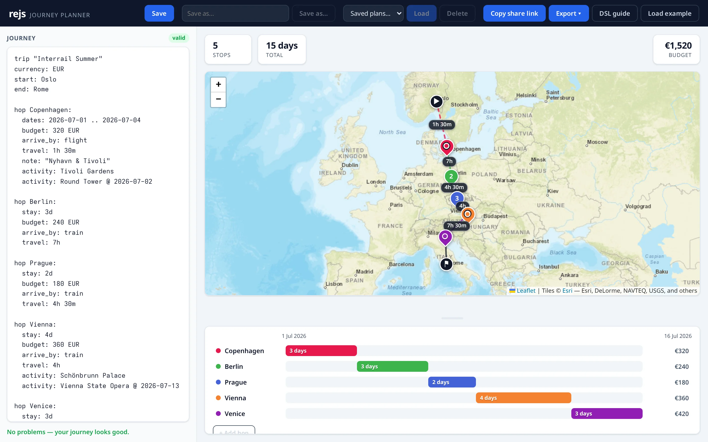
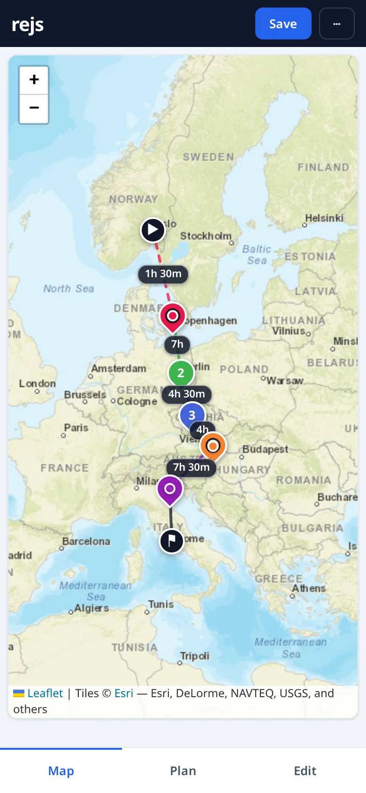

<h1 align="center">rejs</h1>

<p align="center">
  <strong>Plan, visualize, and compare longer journeys from a small text DSL — entirely in your browser.</strong>
</p>

<p align="center">
  <a href="https://rejs.lillevang.dev"></a>
  <a href="https://github.com/Lillevang/rejs/actions/workflows/ci.yml"></a>
  <a href="./LICENSE"></a>
</p>

<p align="center">
  <a href="https://rejs.lillevang.dev">
    
  </a>
</p>

rejs is a backend-free journey planner. You write a plain-text description of a
trip — hops, stays, activities, budgets, transport legs — into an editor, and on
every keystroke the app parses it and re-renders three synced views:

- a **Summary** (stops, days, per-currency budget),
- a **Leaflet map** (numbered pins, colored legs, dashed flight/ferry lines,
  drive stops, activity markers, leg-time labels), and
- a Gantt-style **Timeline**.

The DSL text is the single source of truth — there is no separate model and no
server. Place names are resolved to coordinates via the public
[Nominatim](https://nominatim.openstreetmap.org/) geocoding API (deduped and
cached client-side), and plans persist in `localStorage`. Nothing leaves your
browser except geocoding lookups.

---

## Try it

**[rejs.lillevang.dev](https://rejs.lillevang.dev)** opens with an example
Interrail trip loaded. Edit the text on the left and watch the map and timeline
follow; press **DSL guide** in the toolbar for the full syntax.

To run it locally (Node.js 20+ and npm):

```bash
npm install        # install dependencies
npm run dev        # start Vite on http://localhost:5173
```

### Scripts

| Command             | What it does                               |
| ------------------- | ------------------------------------------ |
| `npm run dev`       | Start the Vite dev server (port 5173)      |
| `npm run build`     | Type-check (`tsc -b`) and build to `dist/` |
| `npm run preview`   | Serve the production build locally         |
| `npm test`          | Run unit tests (Vitest)                    |
| `npm run e2e`       | Run end-to-end tests (Playwright)          |
| `npm run lint`      | Lint with ESLint                           |
| `npm run typecheck` | Type-check without emitting                |
| `npm run format`    | Format with Prettier                       |

---

## The DSL

A plan is plain text. The smallest useful trip is a title and a couple of hops:

```
trip "Interrail Summer"
currency: EUR
start: Oslo
end: Rome

hop Copenhagen:
  dates: 2026-07-01 .. 2026-07-04
  budget: 320 EUR
  arrive_by: flight
  travel: 1h 30m
  note: "Nyhavn & Tivoli"
  activity: Tivoli Gardens
  activity: Round Tower @ 2026-07-02

hop Berlin:
  stay: 3d
  budget: 240 EUR
  arrive_by: train
  travel: 7h
```

### Reference

| Field / block      | Meaning                                                                                        |
| ------------------ | ---------------------------------------------------------------------------------------------- |
| `trip "Name"`      | Trip title.                                                                                    |
| `currency: EUR`    | Default currency for bare budget amounts.                                                      |
| `start:` / `end:`  | Journey endpoints, drawn as markers joined to the first/last hop. A place name or `lat, lng`.  |
| `hop Name:`        | A stop. Everything indented beneath it belongs to that hop.                                    |
| `dates: A .. B`    | An explicit date window for a hop (`YYYY-MM-DD .. YYYY-MM-DD`).                                |
| `stay: Nd`         | A hop's length in days; chains from the previous hop when no `dates:` is given.                |
| `budget: 800 EUR`  | Per-hop budget, summed per currency. A bare amount uses the trip's default currency.           |
| `arrive_by: train` | How you arrive into the hop. Modes: `flight`, `train`, `bus`, `ferry`, `car`, `walk`.          |
| `travel: 4h 30m`   | Leg duration, shown on the map line.                                                           |
| `activity: X`      | Something to do at a hop, geocoded and marked. Add `@ YYYY-MM-DD` for a fixed, must-book date. |
| `coords: lat, lng` | Pin a hop precisely, or somewhere geocoding can't find.                                        |
| `note: "..."`      | Free-text note on a hop.                                                                       |
| `drive -> Dest:`   | A drive block between two hops; each `stop:` is one overnight (add `2d` for more). See below.  |
| `# comment`        | Comments anywhere; ignored by the parser. Inline `# ...` works too.                            |

**Road trips** break a drive into overnight stops:

```
hop Sydney:
  stay: 6d
drive -> Melbourne:
  by: car
  stop: Canberra
  stop: Lakes Entrance 2d
hop Melbourne:
  stay: 4d
  arrive_by: car
```

The in-app **DSL guide** (the help button in the toolbar) is the canonical,
always-current reference — every snippet in it is parsed by a test so it can't
drift out of sync with the parser.

---

## Features

- **Live, three-way view** — Summary, map, and timeline re-render on every keystroke.
- **Geocoding with disambiguation** — place names resolve via Nominatim; when a
  name is genuinely ambiguous (e.g. "Venice"), an inline chooser lets you pick
  the right match instead of silently guessing.
- **Direct map editing** — drag a hop's pin, or click the map to place the active
  hop; the change is written back into the DSL as `coords:`.
- **Quick-add** — a "+ Add hop" button appends a well-formed hop block so you
  don't have to remember the syntax to get started.
- **Date sanity hints** — gentle warnings for an activity dated outside its hop's
  window, or a gap/overlap between dated hops.
- **Saving** — one autosaved working buffer plus named save slots, all in
  `localStorage`. "Save" overwrites the loaded plan in place; "Save as…" creates
  a new slot; an "• unsaved changes" hint shows when the buffer diverges.
- **Shareable links** — a plan is encoded into a self-contained URL. With the
  url-shortener configured, "Copy share link" mints a short, stable link that
  keeps pointing at the latest plan as it's edited; otherwise it falls back to
  the long self-contained link. See [`docs/share-links.md`](./docs/share-links.md).
- **Export** — print / save as PDF (clean print stylesheet), or download a
  calendar `.ics` (one all-day event per hop, fixed-date activities as events).
- **Phone layout** — below 640px the three views become full-bleed **Map /
  Plan / Edit** tabs, with the map as the default so the plan is useful on the
  road.
- **First-run hint** — a one-line, dismissible nudge above the editor on a
  genuine first visit explains the text-as-UI model and points to the DSL guide;
  it never shows again once dismissed (or for returning users with saved plans).

<p align="center">
  
</p>

---

## Architecture

React 19 + TypeScript, bundled by Vite 6. No backend — everything runs in the
browser. Unit tests use Vitest (+ Testing Library, jsdom); end-to-end tests use
Playwright.

```
src/
  dsl/          the language — parse.ts (text → AST), resolve.ts (AST →
                resolved plan + diagnostics), edit.ts (programmatic DSL edits),
                types.ts. This is the core; start here.
  geocode/      nominatim.ts place-name → coordinates lookup (+ ambiguity.ts).
  state/        store.ts (localStorage persistence), use-geocoder.ts, and the
                layout hooks (use-media-query.ts, use-resizable-height.ts).
  components/   Editor.tsx, MapView.tsx, Timeline.tsx, Summary.tsx,
                Diagnostics.tsx, Toolbar.tsx, HelpModal.tsx, FirstRunHint.tsx,
                OrientationHint.tsx.
  lib/          pure helpers — dates, colors, formatting, duration, share
                links, the DSL reference, export/ (.ics, downloads), and the
                seed example plan.
  App.tsx       composition root (desktop split vs. phone tabs).
```

The data flow is one-directional: **DSL text → `parse` → `resolve` → render**.
Every feature that "edits the plan" (dragging a pin, quick-add, picking a
geocode candidate) does so by editing the DSL text and letting the pipeline
re-render — the text stays the single source of truth.

For the internals in depth — the pipeline, module map, geocoding, and
persistence — see [`docs/architecture.md`](./docs/architecture.md). Full
project documentation lives in [`docs/`](./docs/README.md).

---

## Development

- Unit tests live next to the code they cover (`foo.ts` + `foo.test.ts`);
  end-to-end specs live in `tests/e2e/`. Run `npm test` and `npm run e2e`.
- The full local gate — format, lint, type-check, unit and e2e tests — is
  `./.agent/scripts/check.sh` (or `just check`). CI runs the same checks
  (with Prettier in `--check` mode) on every push and pull request.
- Commits follow [Conventional Commits](https://www.conventionalcommits.org/)
  (`feat:`, `fix:`, `docs:`, …), one logical change per commit.
- The repo is set up for agent-assisted development: the working agreement
  lives in [`AGENTS.md`](./AGENTS.md), with a generated file map in
  [`.agent/CODEBASE.md`](./.agent/CODEBASE.md). Open ideas are tracked in
  [`IDEAS.md`](./IDEAS.md); shipped ones are archived in
  [`IMPLEMENTED.md`](./IMPLEMENTED.md).

---

## Deployment

The app builds to a static `dist/` and is served by nginx. A `Dockerfile`
(multi-stage build → `nginx-unprivileged` on port 8080, with a `/healthz`
endpoint) and a `Taskfile.yaml` (`task build` / `task verify` / `task release`)
package and publish the container image to GHCR. Releases are cut **locally**:
`task release` builds, pushes, signs the image digest with cosign (key injected
from 1Password), verifies the signature, scans it, and commits the artifacts.
There is no CI image build — the cluster requires signed images and the signing
key never leaves 1Password.

See [`docs/deploy/container.md`](./docs/deploy/container.md) for the
release/signing details and
[`docs/deploy/infra-onboarding.md`](./docs/deploy/infra-onboarding.md) for the
GitOps onboarding runbook.

---

## License

[MIT](./LICENSE) © Jeppe Lillevang Salling
